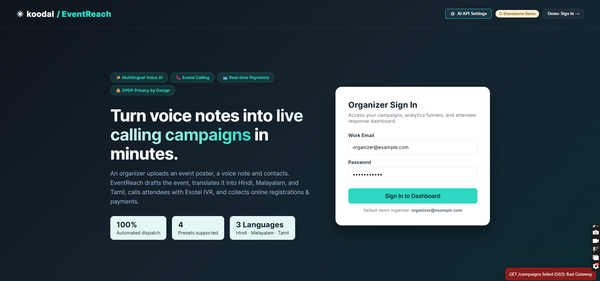

# DEFINE 4.0

The official project submission repository for **DEFINE 4.0 — The World's Realest Hackathon**.

---

# Koodal

<!-- Add your project cover image below -->


## Team Information

- **Team Name**: Untitled(5)
- **Track**: Software

## Team Members

| Name | Role | GitHub | LinkedIn |
|------|------|--------|----------|
| Gayathri | Backend | [@username](https://github.com/gtrish) | [Profile](https://linkedin.com/in/gayathri-girish-a7b604360) |
| Agila Benedict | Backend | [@username](https://github.com/agiaben) | [Profile](https://linkedin.com/in/agila-benedict-846580360) |
| Akshay T Manoj | Frontend | [@username](https://github.com/Akshaytm310) | [Profile](https://linkedin.com/in/akshay-t-manoj-57a962330) |
| Aleena Liz Thomas | Frontend | [@username](https://github.com/aleenalizthomas) | [Profile](https://linkedin.com/in/aleena-liz-thomas-542a7a326) |
| Milind Krishna P | Frontend | [@username](https://github.com/mylel12prime007) | [Profile](https://linkedin.com/in/milind-krishna-p-829b08338) |
---

# Project Details

## Overview
Koodal turns an event poster, a spoken voice note and a contact list into a multilingual calling campaign, with email and WhatsApp follow-up. It captures each person’s reply by keypad or speech, links them to a registration and payment page, and shows live outcomes by language and audience segment on one dashboard. It solves the problem of institutions being unable to reach large audiences in their own languages, track responses and protect personal data without days of manual work.

## Problem Statement

What is the problem?
Institutions invite people to seminars, clinics, schools and payments by calling contact by contact or sending one message in one language. Replies are scattered, non-responders are chased by hand, and contact data is handled loosely.

Who is affected by it?
Organizers lose days to manual outreach and learn who is coming too late. Recipients who speak regional languages, or who don’t use email and apps, are missed. Everyone’s phone numbers and voices are personal data at risk.

Why is solving it important?
An event or reminder only works if people hear about it in a language they understand and respond in time. A phone call is still the most widely reachable channel in India, so making it scalable, measurable and private matters.

What are the limitations of existing solutions?
Manual calling: slow, with no record of outcomes
Bulk SMS and email: one language and no confirmed reply
Generic IVR tools: no event flow, registration or payment
Single-purpose apps: each new use case needs a new tool
Common gap: replies are not captured in one place, retries are manual, and privacy controls are often missing

## Solution
Core idea
Koodal turns a poster, a voice note and a contact list into a live multilingual calling campaign. A scripted text-to-speech message carries the invitation, and keypad input captures the reply, with speech recognition as a best-effort extra. We chose this over a full conversational agent because it is cheaper, more predictable and easier to verify in Hindi and Malayalam, and a yes, no or call-back decision doesn’t need more.

Workflow

1.Set up: the organizer picks a template and uploads a poster and voice note, and AI fills in the event details for review
2.Audience: a CSV is validated, and phone numbers are normalized and encrypted
3.Translate: one message per language, back-translated to check facts, and approved by the organizer
4.Launch: contacts are called in their own language, replying with keypad options (1 confirm, 2 decline, 3 call back), with voicemail handled
5.Register and pay: each contact gets a personal link to register with consent, pay in test mode and give feedback
6.Track and act: a live dashboard shows outcomes by language and segment, with one-click retry of non-responders and fallback to email or WhatsApp

Key technologies
React and Vite (frontend), FastAPI and PostgreSQL (backend), Exotel (calls and keypad), Gemini (transcription, extraction, translation), SMTP (email), and a test-mode payment gateway.

# Demo

### Demo Video

[Watch Project Demo](https://drive.google.com/drive/folders/1BNyrDOjm8Sd7aNjYtkwLch4b8VnbL22D?usp=drive_link)


### Screenshots

<!-- Add screenshots of your project here -->




---

# Live Project

[Visit Live Project](https://your-project-url.com/)

---

# Technical Implementation

## Technologies Used

| Category | Technologies |
|----------|--------------|
| **Frontend** | React + Viteport 5173,  |
| **Backend** | Python 3.13, FastAPI, uvicorn |
| **Database** | PostgreSQL, psycopg3+pool |
| **APIs / Services** |  |
| **AI / ML** | Gemini, Groq or OpenAI via voice_pipeline.py |
| **DevOps / Deployment** | Technologies |
| **Other Tools** | Technologies |

## System Architecture

<!-- Add your architecture diagram here -->


## Key Features

- Poster + voice note + CSV → live campaign in under 10 minutes
- Auto-extracted event details (title, date, venue, fee), reviewed by the organizer
- Multilingual calls (English, Hindi, Malayalam) with translations approved after back-translation
- Keypad capture (1 confirm, 2 decline, 3 call back, 9 stop), plus spoken yes/no where supported
- Voicemail handling, opt-out, calling hours, and retries (max 3 attempts)
- Live dashboard by language and segment, with a “Retry non-responders” action
- Template-driven: seminar, clinic, school and payment use one engine

# Setup Instructions

## Prerequisites

Make sure the following are installed before running the project:

- Requirement 1
- Requirement 2
- Requirement 3

## Installation

### 1. Clone the Repository

```bash
git clone <repository-url>
